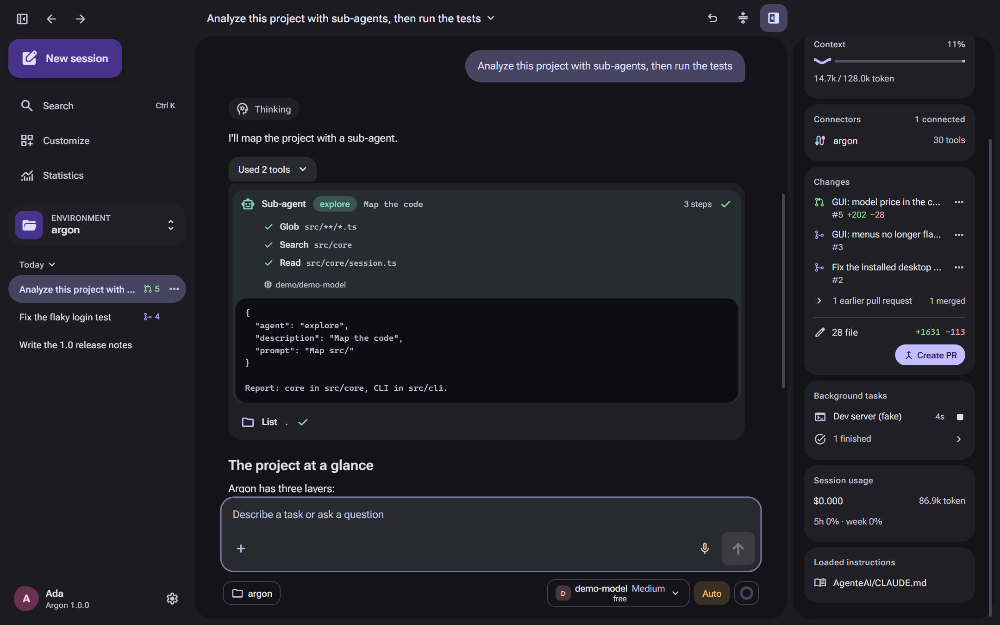
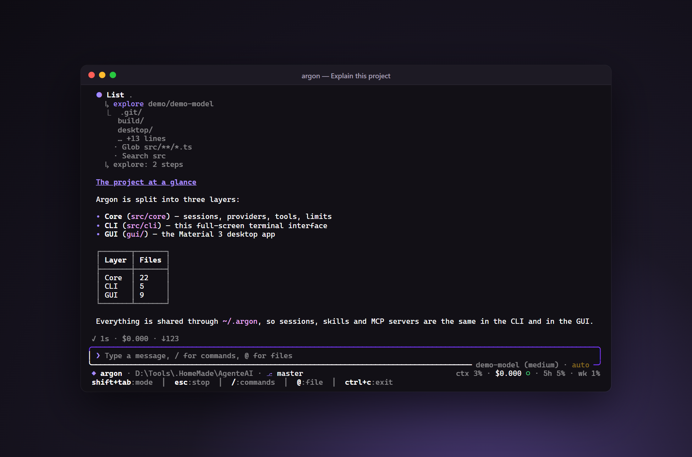
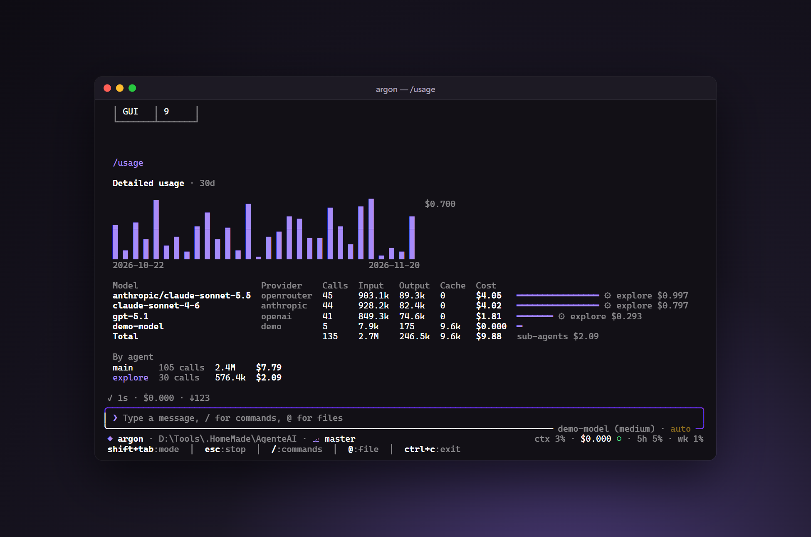
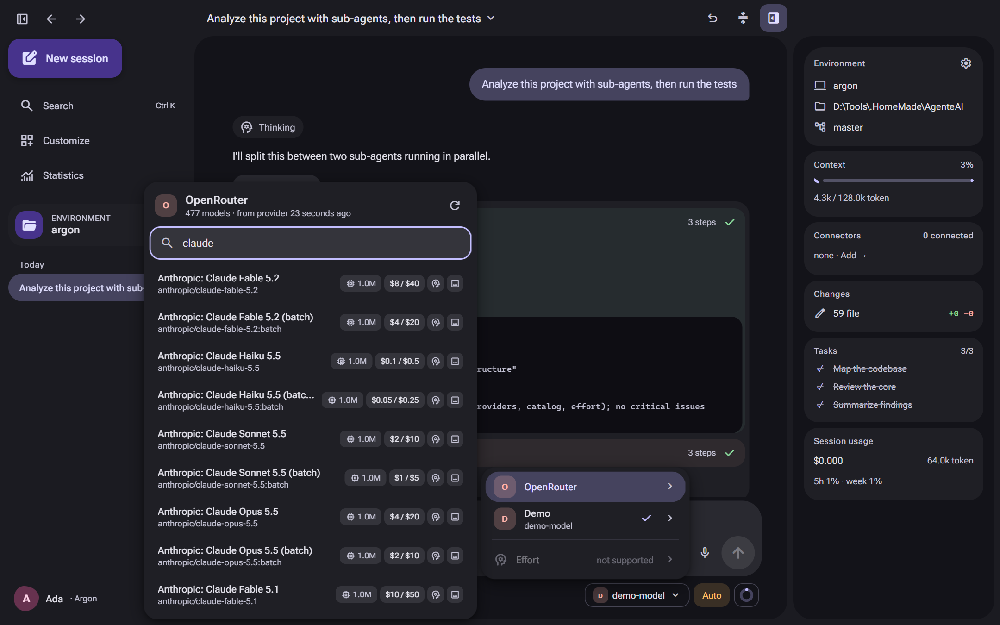
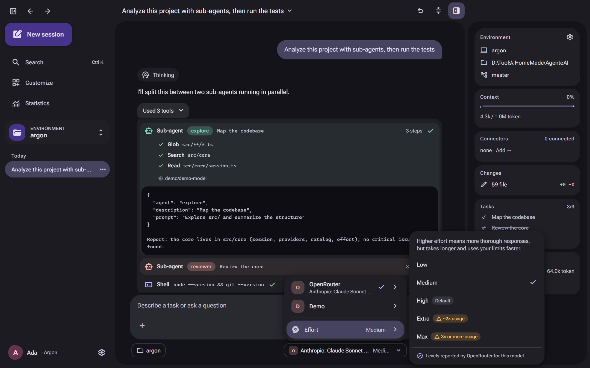
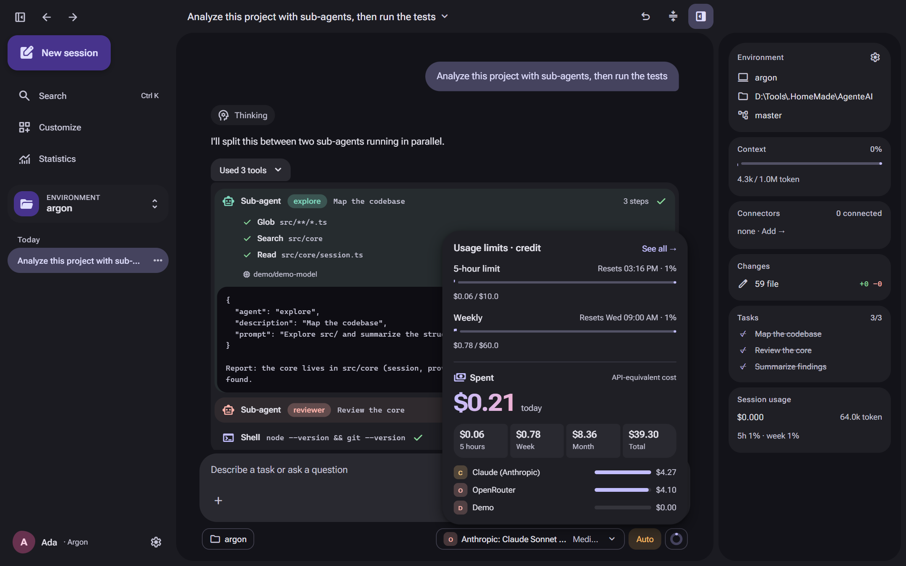
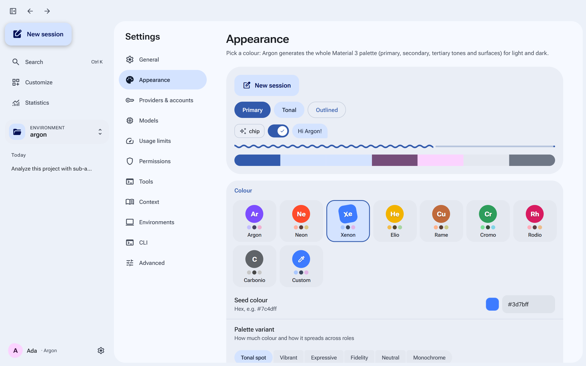
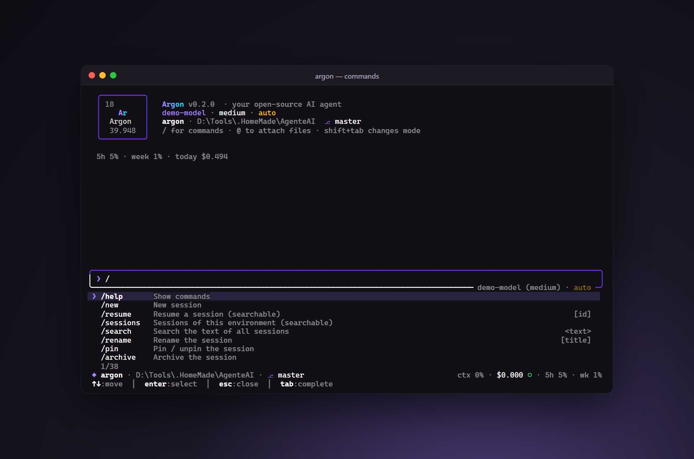
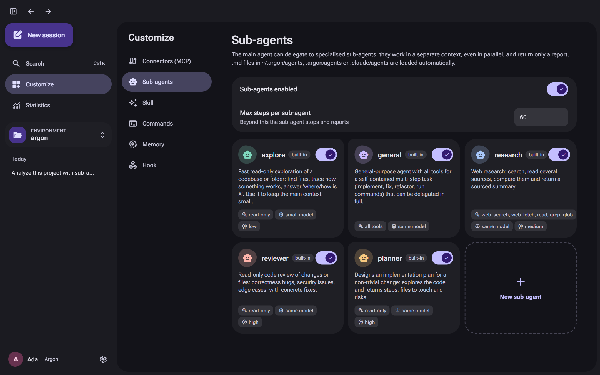

<div align="center">


# Argon

**An open-source AI agent with a full-screen Rust CLI and a Material 3 desktop app (Tauri).**
Any provider · live model catalogs · MCP · skills · sub-agents · usage limits · GitHub PRs

[](LICENSE)
[](https://github.com/mikqsdev/argon/releases)


<sub>Ar · 18 · 39.948 — the noble gas that glows violet when ionised.</sub>



</div>

---

Argon is a coding and general-purpose agent that runs on your machine. It is built on the solid core of **[Pi](https://github.com/badlogic/pi-mono)** (`pi-ai` + `pi-agent-core`) for the agent loop and multi-provider streaming, and adds everything around it: tools, permissions and an environment sandbox, MCP, skills, sub-agents, memory, live model catalogs, usage limits with a spending counter, GitHub pull requests, a full-screen **CLI written in Rust** and a **Tauri desktop app** that share the same sessions and settings.

```
argon (Rust CLI) ──HTTP/WS──┐
                            ├── Argon core (TypeScript + Pi, local server on 127.0.0.1) ── ~/.argon
Argon (Tauri app) ─webview──┘
```

## Highlights

| | |
|---|---|
| 🔌 **Any provider** | Claude (API key or Pro/Max sign-in), OpenAI (API key or ChatGPT sign-in), OpenRouter, Gemini, GitHub Copilot, xAI, Groq, Mistral, DeepSeek, Bedrock, Azure, Ollama, LM Studio and any OpenAI-compatible server. One account or key per provider. |
| 📡 **Live model catalogs** | Model lists come straight from each provider (OpenRouter: 470+ models with prices and context). Reasoning levels are read **per model** from the provider — including `max`, the provider's default and whether reasoning can be turned off. |
| 🧭 **Usage limits** | Optional 5-hour and weekly limits, in tokens or dollars, with a ring indicator, alerts near the threshold and a spending counter (today, 5h, week, month, total — sub-agents included). |
| 🤖 **Sub-agents** | `explore`, `general`, `research`, `reviewer`, `planner` + your own (`.md` files, Claude Code compatible). They run in parallel, each with its own model, tools and effort, with live progress. |
| 🧰 **Tools & MCP** | read/write/edit, shell (with background processes), grep/glob, web search & fetch, todo, memory, skills, ask-user, and any MCP server (stdio, HTTP, SSE). |
| 🛡️ **Environment sandbox** | Inside an environment, writing outside its folder always asks first — even in Auto mode. |
| 🐙 **GitHub** | Connect a token or the GitHub CLI and open pull requests from a session (`/pr` or the *Create PR* button). |
| 🔄 **CLI ⇄ GUI sync** | Chats, skills, MCP, default model, mode and limits are shared live. CLI sessions can be imported into the GUI with their git context. |
| 🎨 **Material 3 Expressive** | Dynamic colour palettes from any seed colour, light/dark, shape and motion settings, lots of animation. |

## Screenshots

<table>
<tr>
<td width="50%"><br><sub><b>CLI</b> — full-screen terminal UI with a fixed input box, status row, cost and usage ring</sub></td>
<td width="50%"><br><sub><b>/usage</b> — cost per model, provider and sub-agent, with a 30-day chart</sub></td>
</tr>
<tr>
<td><br><sub>Provider → model menu with live lists, search, context and prices</sub></td>
<td><br><sub>Reasoning levels reported by the provider for each model</sub></td>
</tr>
<tr>
<td><br><sub>5-hour and weekly limits with the spending counter</sub></td>
<td><br><sub>Material 3 palettes generated from any colour</sub></td>
</tr>
<tr>
<td><br><sub>Every GUI feature is a <code>/command</code> in the CLI, with live suggestions</sub></td>
<td><br><sub>Built-in and custom sub-agents</sub></td>
</tr>
</table>

<sub>Screenshots show demo data and a test model.</sub>

## Install

### Windows installer

Download the **`Argon_<version>_x64-setup.exe`** installer from the [latest release](https://github.com/mikqsdev/argon/releases/latest) and run it (no admin rights needed). It installs:

- **Argon**: the desktop app, a native Tauri window (Start menu shortcut);
- **`argon`**: the Rust CLI, added to your user `PATH` automatically (open a new terminal and type `argon`);
- the Argon core with its own Node.js runtime, so nothing else is needed.

The uninstaller removes everything, takes `argon` off the `PATH`, and asks whether to delete your data (`%USERPROFILE%\.argon`). The installer is not code-signed yet, so Windows SmartScreen may ask for confirmation (*More info → Run anyway*).

### From source (Windows, macOS, Linux)

Requires Node.js 22+ and Rust (stable). On Windows, use the MSVC toolchain (Visual Studio Build Tools) or the GNU one plus MinGW binutils (`winget install BrechtSanders.WinLibs.POSIX.UCRT`).

```bash
git clone https://github.com/mikqsdev/argon.git
cd argon
npm install
npm run build                         # the core
cd rust && cargo build --release      # target/release/argon (CLI) and argon-desktop (app)
```

`npm run cli` and `npm run desktop` run the CLI and the app from source, and `npm run dist` builds the installer. `npm run gui` opens the GUI in the browser instead.

## Quick start

```bash
argon login                 # connect a provider (OAuth sign-in or API key)
argon                       # start chatting in the current folder
argon "fix the failing test"
argon -p "summarise README.md"      # headless, prints the answer (pipes work)
argon -c                    # continue the last session here
argon -m openrouter/anthropic/claude-sonnet-5.5 --mode plan
```

> Claude Pro/Max sign-in: Anthropic's terms may restrict using subscriptions outside its own apps. Use at your own risk — an API key is the supported route.

## The CLI

`argon` is a native Rust binary that opens a full-screen terminal interface. The transcript scrolls above and stays in your terminal's scrollback. A fixed panel below holds:

- the input box;
- the model · effort · mode label;
- a status row: environment, folder, git branch, detected context files such as `AGENTS.md`, session cost and the usage ring;
- keyboard hints.

It connects to the core the desktop app is running. If the app isn't running, it starts a private core and stops it on exit.

| Key | Action |
|---|---|
| `/` | command suggestions (live, with descriptions) |
| `@` | attach or mention files (images are sent to the model) |
| `Shift+Tab` | cycle permission mode (Ask → Accept edits → Auto → Plan) |
| `Esc` | stop the agent · close menus |
| `↑ ↓` | history / move in menus · type to search in any menu |
| `\` + Enter, `Alt+Enter` | new line |
| `Ctrl+C` twice | exit |

Commands (all GUI features are available): `/new /resume /sessions /search /rename /pin /archive /delete /export /clear /compact /undo /todos /context /model /effort /mode /login /logout /providers /github /pr /limits /usage /stats /mcp /agents /subagents /bgterminals /skills /memory /hooks /env /settings /init /gui /help /exit`, plus your custom commands and skills.

`/settings` holds the CLI's own preferences (language, colours, animations, timestamps, which sessions to show, limit alerts) — independent from the GUI and also editable in *GUI → Settings → CLI*. By default `/resume` and `/sessions` show the sessions of the environment you are in.

## The desktop app

- **Sidebar** — new session, search, customise, statistics, the current **environment** card and its sessions.
- **Composer** — attachments, dictation (browser version), environment, provider → model menu, effort, permission mode and the usage ring.
- **Session** — streaming transcript with grouped tools, diffs, sub-agent cards with live steps, approval cards, task list; right panel with environment, git branch, context, connectors, changes + **Create PR**, session git (PRs, commits), background terminals and cost.
- **Settings** — General, Appearance, Providers & accounts (with favicons), GitHub, Models, Usage limits, Permissions (sandbox), Tools, Context (`/init` file name), Environments, CLI, Advanced (raw JSON).
- **Customise** — MCP connectors, sub-agents, skills, commands, memory, hooks.
- **/usage** — detailed usage per model and provider, sub-agents itemised.

## Concepts

### Environments and the sandbox
An environment is a working folder with its own sessions and defaults (model, permission mode). The sidebar and the composer always show the same current environment. When a session belongs to an environment, any write outside that folder (subfolders are fine) **asks for approval even in Auto mode** — exact for `write`/`edit`, best-effort for shell commands. *Always allow* approves that external folder for the session only. Toggle it in *Settings → Permissions*.

### Usage limits and spend
Limits are optional (*Settings → Usage limits* or `argon limits`): a 5-hour window (Claude-style, starting with the first message, or rolling) and a weekly window with a configurable reset day and hour, counted in tokens or in dollars. At 100% Argon blocks new turns (or only warns). Costs are API-equivalent prices and **include sub-agents, titles and compaction**. Limits are the one setting the CLI and GUI always share.

### Reasoning levels
For every model Argon asks the provider which effort levels it supports, which one is the default and whether reasoning is mandatory, then sends the provider's exact value (for example `max`). Newer Claude models get adaptive thinking with effort. When a provider doesn't report levels, Pi's catalog is used.

### Sub-agents
The main agent delegates with the `task` tool. Define your own in `~/.argon/agents/<name>.md` or `<project>/.argon/agents/` (`.claude/agents` also works):

```markdown
---
name: tester
description: Writes and runs tests for a change
tools: read, grep, glob, bash, edit, write   # or "all" / "read-only"
model: inherit                               # or provider/model, or "small"
effort: medium
color: "#7fd8be"
---
You are a meticulous tester…
```

### Skills, commands, memory, hooks
- **Skills** — `SKILL.md` folders in `~/.argon/skills/` or `.argon/skills/` (Claude-compatible), loaded when relevant or via `/name`.
- **Commands** — `~/.argon/commands/<name>.md` with `$ARGUMENTS`, `$1`, `$2`.
- **Instructions** — `~/.argon/ARGON.md`, plus `ARGON.md` / `AGENTS.md` / `CLAUDE.md` from the repo root down. `/init` writes the file named in *Settings → Context*.
- **Memory** — facts saved across sessions (global or per project).
- **Hooks** — shell commands on `sessionStart`, `userPrompt`, `preToolUse` (exit code 2 blocks), `postToolUse`, `stop`.

### GitHub
Connect a personal access token (`repo`, `workflow`) in *Settings → GitHub* or with `/github`, or just be signed in to the GitHub CLI (`gh auth login`). Then `/pr` (or *Create PR*) commits pending changes, pushes a branch and opens the pull request with `gh`.

### CLI ⇄ GUI
Both use `~/.argon` (override with `ARGON_HOME`): `settings.json`, `auth.json`, `usage.jsonl`, `sessions/`, `skills/`, `agents/`, `commands/`, `memory/`. Changes made by one are picked up live by the other. Sessions started in the CLI show up in the GUI once imported (*Import sessions from Argon CLI* on the home screen), together with their environment, last model and mode, branch, recent commits and pull requests.

## Development

```bash
npm run build      # core: TypeScript → dist/
npm test           # end-to-end tests with a fake model (no network)
npm run cli        # Rust CLI from source
npm run desktop    # Tauri app from source (tauri dev)
npm run dist       # Windows installer → rust/target/release/bundle/nsis/
cd rust && cargo test
```

`test/fixtures/faux-core.mjs` is a core with a fake model. Point the clients at it with `ARGON_NODE=node ARGON_CORE_ENTRY=test/fixtures/faux-core.mjs` and a throwaway `ARGON_HOME` to try them without network.

See [CLAUDE.md](CLAUDE.md) for the architecture and conventions.

## Acknowledgements

- [Pi](https://github.com/badlogic/pi-mono) by Mario Zechner — agent loop, providers and OAuth (MIT)
- [Model Context Protocol SDK](https://github.com/modelcontextprotocol/typescript-sdk) (MIT)
- [Tauri](https://tauri.app/) (MIT/Apache 2.0), [crossterm](https://github.com/crossterm-rs/crossterm), [ureq](https://github.com/algesten/ureq), [tungstenite](https://github.com/snapview/tungstenite-rs)
- [marked](https://marked.js.org/), [xterm.js](https://xtermjs.org/) (tests)
- [Roboto Flex](https://fonts.google.com/specimen/Roboto+Flex) (OFL) and [Material Symbols](https://fonts.google.com/icons) (Apache 2.0)

## License

[MIT](LICENSE)
